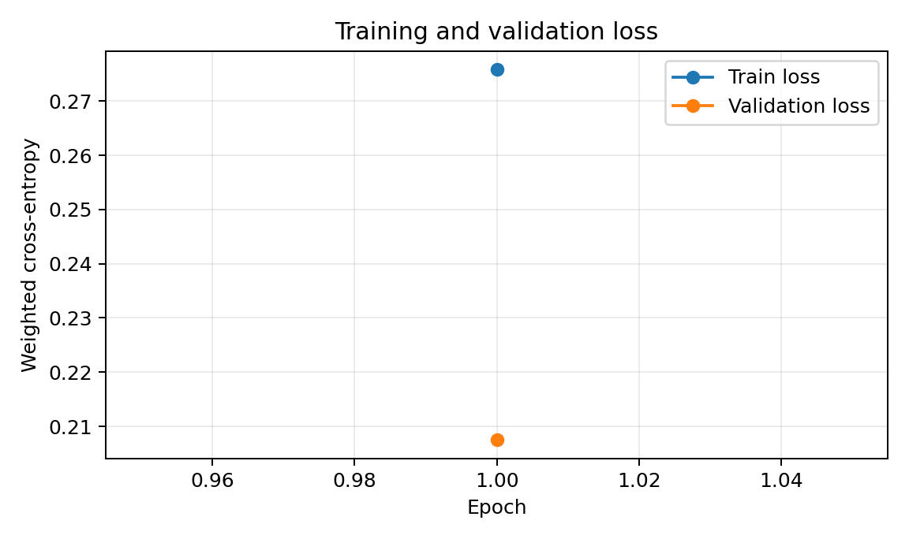
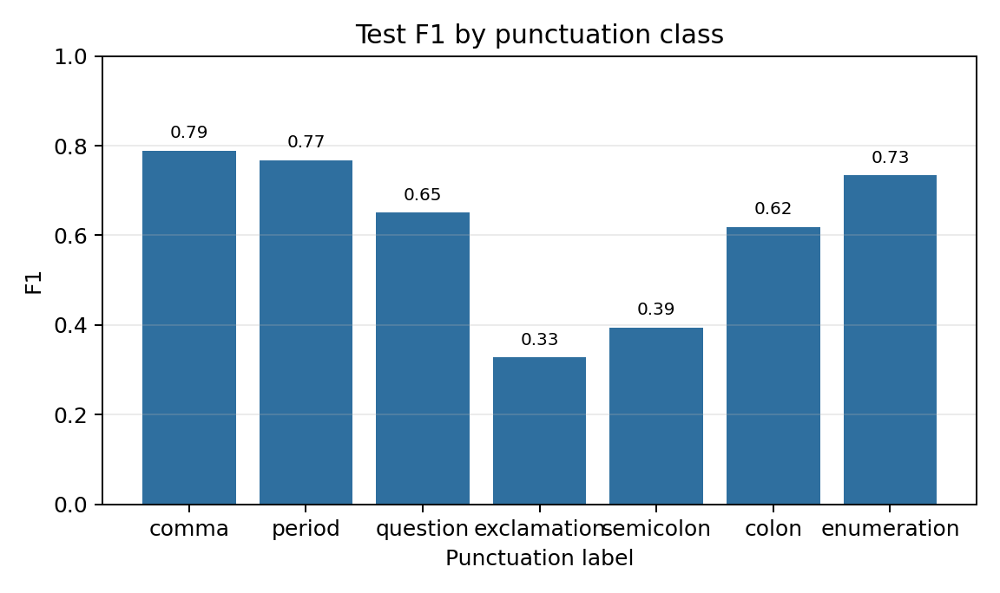
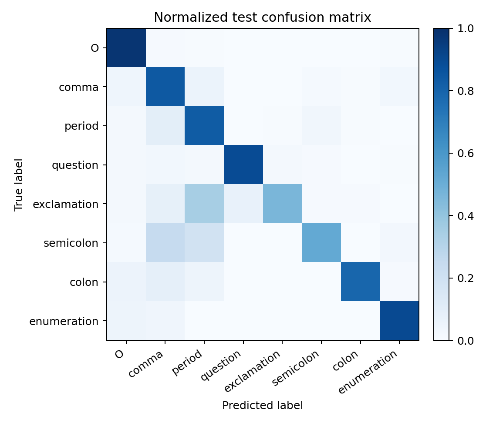
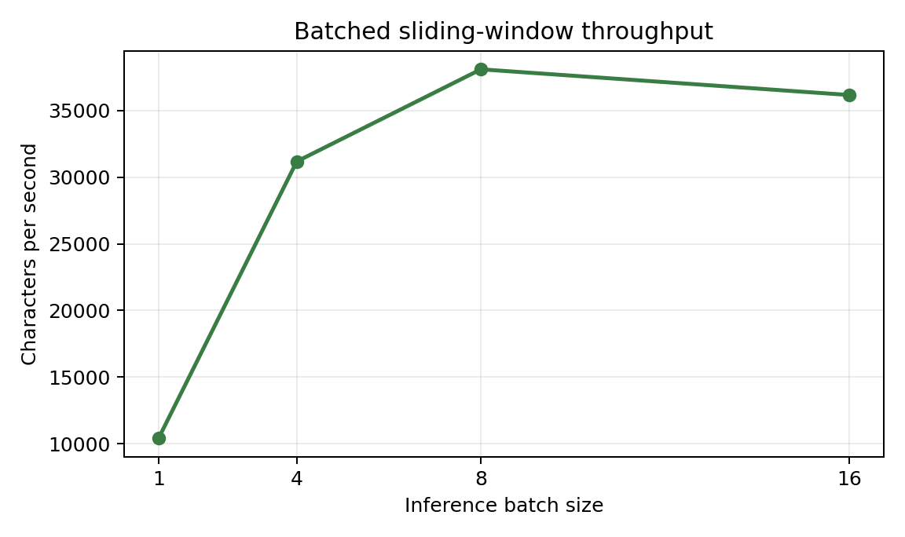

# 基于 BERT 的中文标点恢复实验报告

## 一、实验目的

本实验使用预训练中文 BERT 对带标点文本进行微调，建立逐字符标点预测模型，并针对超过单次输入长度的文章实现重叠滑窗推理。实验进一步比较逐窗口推理与批量窗口推理的标点质量、吞吐和显存占用。

## 二、语料与数据处理

实验语料为工作目录中的《人民日报 1998 年上半年带音语料》，包含 1998 年 1 月至 6 月的 6 个文本文件。文件按 GB18030 编码读取，每行包含文章编号、分词文本及部分词语的拼音注释。预处理去除拼音注释、词间空格和 GB18030 解码产生的替换字符（共移除 5 个），保留其余原文字符；将逗号、句号、问号、感叹号、分号、冒号和顿号作为预测类别，双引号、括号、书名号等其他符号保留在输入中。

模型以每个字符为一个输入单元，预测该字符之后是否应添加标点。原语料中的标点作为监督标签；连续出现在同一字符边界的目标标点按从左到右规则保留第一个，无法对齐的前置标点不参与标签。训练样本按每段最多 254 个字符切分，长段切分后不重叠，避免丢弃标签。

数据集按照文章编号的 SHA-256 哈希确定性划分，训练、验证、测试比例为 80%、10%、10%，同一文章不会跨数据集。处理后的样本和文章数量如下。

| 数据集 | 样本数 | 文章数 | 字符数 |
|---|---:|---:|---:|
| 训练集 | 104,411 | 14,906 | 8,873,449 |
| 验证集 | 13,851 | 1,846 | 1,089,879 |
| 测试集 | 12,797 | 1,879 | 1,093,916 |

标签集合为 `O、，、。、？、！、；、：、`，其中 `O` 表示不添加目标标点。类别计数如下。

| 数据集 | O | 逗号 | 句号 | 问号 | 感叹号 | 分号 | 冒号 | 顿号 |
|---|---:|---:|---:|---:|---:|---:|---:|---:|
| 训练集 | 8,132,768 | 394,815 | 200,246 | 4,327 | 2,824 | 12,980 | 17,305 | 108,184 |
| 验证集 | 999,670 | 47,717 | 24,599 | 479 | 318 | 1,726 | 2,163 | 13,207 |
| 测试集 | 1,003,203 | 48,805 | 24,543 | 489 | 349 | 1,621 | 2,077 | 12,829 |

## 三、模型与训练设置

模型使用 `google-bert/bert-base-chinese` 预训练检查点，在其 Transformer 编码器上增加 8 类 Token Classification 线性分类头。BERT 参数参与端到端微调。Tokenizer 将字符列表作为预切分输入；对每个字符只在其最后一个子词位置计算交叉熵，特殊符号和填充位置通过 `ignore_index=-100` 排除。

类别不平衡通过平方根逆频率权重缓解。优化器为 AdamW，学习率采用线性 warmup 后线性衰减。训练及设备配置如下。

| 项目 | 设置 |
|---|---|
| 训练轮数 | 1 |
| 每卡 batch size | 16 |
| 梯度累积步数 | 1 |
| 有效 batch size | 16 |
| 最大输入长度 | 256 tokens |
| 学习率 | 3e-05 |
| 权重衰减 | 0.01 |
| Warmup 比例 | 10.00% |
| 随机种子 | 42 |
| 计算设备 | GPU |
| 权重计算精度 | FP16 autocast |
| 最佳 checkpoint | 第 1 轮 |
| 训练用时 | 23.3 分钟 |

根据验证集不含 `O` 类的标点 Macro-F1 选择最佳模型。各轮训练和验证表现如下。

| Epoch | 训练损失 | 验证损失 | 验证集标点 Macro-F1（不含 O） |
|---:|---:|---:|---:|
| 1 | 0.2758 | 0.2075 | 64.30% |

图 1 展示训练损失和验证损失的变化。



图 1 训练集与验证集损失曲线

## 四、长文本推理方法

单次输入按最多 512 个 token 设计。长文章采用长度为 448 个字符、步长为 320 个字符的固定滑窗，相邻窗口重叠 128 个字符。将一个文章的所有窗口预先生成后组成 batch 输入模型，避免逐窗等待；重叠区域对各窗口 logits 做中心加权平均，窗口边缘权重较低，最终按类别最大值解码并将标点插回字符之后。

逐窗口动态移动方案需根据当前窗口预测结果决定下一个窗口起点，窗口之间存在依赖，无法在同一篇文章内预先组成完整批次。本实验以固定起点滑窗作为批量化方案，并使用同一组窗口分别按 batch size 1、4、8、16 推理，单独测量批量处理带来的吞吐变化。速度测试选取测试集中字符数最长的 100 篇文章，共 245,255 个字符；每种 batch size 重复 2 次，报告中位耗时。计时包括 tokenizer、模型前向和窗口合并，不包括模型加载及文件读写。

## 五、测试结果

以下指标基于全部 1,879 篇测试文章（1,093,916 个字符），使用批量滑窗推理得到。标点 Macro-F1 不计 `O` 类；句末标点 F1 将句号、问号和感叹号合并为句界类别。

| 指标 | 结果 |
|---|---:|
| 字符准确率 | 96.62% |
| 标点 Macro-F1（不含 O） | 61.20% |
| 句末标点 F1 | 77.32% |

各类别的 Precision、Recall 和 F1 如下。

| 类别 | Precision | Recall | F1 | 支持数 |
|---|---:|---:|---:|---:|
| O | 99.66% | 97.79% | 98.71% | 1,003,203 |
| ， | 74.45% | 84.02% | 78.94% | 48,805 |
| 。 | 71.49% | 83.01% | 76.82% | 24,543 |
| ？ | 51.17% | 89.37% | 65.08% | 489 |
| ！ | 25.31% | 46.42% | 32.76% | 349 |
| ； | 31.70% | 52.19% | 39.44% | 1,621 |
| ： | 50.93% | 78.91% | 61.91% | 2,077 |
| 、 | 62.09% | 89.90% | 73.45% | 12,829 |

图 2 展示测试集各标点类别的 F1。由于问号、感叹号和分号在语料中出现次数较少，其指标波动更明显。



图 2 测试集各标点类别 F1

测试样例（模型输入为去掉目标标点后的文本）：

| 输入（去除目标标点） | 参考标注 | 模型输出 |
|---|---|---|
| 本报北京１２月３１日讯〓记者陈陆军从广播电影电视部获悉自１９９８年１月１日起我国将用３年时间在广播影视系统陆续实行播音员主持人持证上岗制度 | 本报北京１２月３１日讯〓记者陈陆军从广播电影电视部获悉：自１９９８年１月１日起，我国将用３年时间在广播影视系统陆续实行播音员主持人持证上岗制度。 | 本报北京１２月３１日讯〓记者陈陆军从广播电影电视部获悉：自１９９８年１月１日起，我国将用３年时间，在广播影视系统陆续实行播音员、主持人持证上岗制度。 |
| 今天上午中共中央政治局委员李铁映与广播电影电视部部长孙家正国家语委主任许嘉璐等向第一批获得《播音员主持人资格证书》的中央三台代表颁证 | 今天上午，中共中央政治局委员李铁映与广播电影电视部部长孙家正、国家语委主任许嘉璐等，向第一批获得《播音员主持人资格证书》的中央三台代表颁证。 | 今天上午，中共中央政治局委员李铁映与广播电影电视部部长孙家正、国家语委主任许嘉璐等，向第一批获得《播音员主持人资格证书》的中央三台代表颁证。 |
| 据介绍播音员主持人持证上岗工作是在１９９６年全国广播影视系统语言工作会议上提出来的它是加强宣传队伍建设促进语言文字走向标准化规范化的重要举措播音员主持人只有通过汉语普通话水平测试和政治业务考核后才能获得上岗资格证书 | 据介绍，播音员、主持人持证上岗工作，是在１９９６年全国广播影视系统语言工作会议上提出来的，它是加强宣传队伍建设，促进语言文字走向标准化、规范化的重要举措。播音员、主持人只有通过汉语普通话水平测试和政治、业务考核后才能获得上岗资格证书。 | 据介绍，播音员主持人持证上岗工作，是在１９９６年全国广播影视系统语言工作会议上提出来的。它是加强宣传队伍建设、促进语言文字走向标准化、规范化的重要举措。播音员、主持人只有通过汉语、普通话水平测试和政治业务考核后，才能获得上岗资格证书。 |
| 李铁映在颁证会上称赞“持证上岗”是一个好制度是广播电视事业法制化规范化的一个很大的进步他说播音员主持人“责任重大工作神圣”一言一行都涉及人民的根本利益和国家的安稳他鼓励广大播音主持人员要让世界人民从你们的言行中看到中国人民走向新世纪的崭新精神风貌 | 李铁映在颁证会上称赞“持证上岗”是一个好制度，是广播电视事业法制化、规范化的一个很大的进步。他说，播音员、主持人“责任重大，工作神圣”，一言一行都涉及人民的根本利益和国家的安稳。他鼓励广大播音主持人员：要让世界人民从你们的言行中看到中国人民走向新世纪的崭新精神风貌。 | 李铁映在颁证会上称赞，“持证上岗”是一个好制度，是广播电视事业法制化、规范化的一个很大的进步。他说，播音员、主持人“责任重大，工作神圣”，一言一行，都涉及人民的根本利益和国家的安稳。他鼓励广大播音主持人员，要让世界人民从你们的言行中，看到中国人民走向新世纪的崭新精神风貌。 |
| 颁证会后李铁映同志与出席会议的播音员主持人合影留念广播电影电视部副部长田聪明主持了今天的颁证会 | 颁证会后，李铁映同志与出席会议的播音员、主持人合影留念。广播电影电视部副部长田聪明主持了今天的颁证会。 | 颁证会后，李铁映同志与出席会议的播音员、主持人合影留念。广播电影电视部副部长田聪明主持了今天的颁证会。 |
| 中国驻突尼斯大使吴传福１２月３０日代表中国政府向突尼斯“全国互助基金”无偿提供了价值３００万人民币的录像机照相机电脑以及各种球类等体育用品和设备（本报专电） | 中国驻突尼斯大使吴传福１２月３０日代表中国政府向突尼斯“全国互助基金”无偿提供了价值３００万人民币的录像机、照相机、电脑以及各种球类等体育用品和设备。（本报专电） | 中国驻突尼斯大使吴传福１２月３０日代表中国政府向突尼斯“全国互助基金”无偿提供了价值３００万人民币的录像机、照相机、电脑，以及各种球类等体育用品和设备。（本报专电） |
| 中国首次制造和首批出口的８０多个多用途液体罐式集装箱１２月３０日在达累斯萨拉姆顺利通过坦赞铁路局的验收开始在坦赞铁路线上投入使用 | 中国首次制造和首批出口的８０多个多用途液体罐式集装箱１２月３０日在达累斯萨拉姆顺利通过坦赞铁路局的验收，开始在坦赞铁路线上投入使用。 | 中国首次制造和首批出口的８０多个多用途液体罐式集装箱，１２月３０日在达累斯萨拉姆顺利通过坦赞铁路局的验收，开始在坦赞铁路线上投入使用。 |
| 元月一日全国政协举行新年茶话会江泽民李鹏乔石朱镕基李瑞环刘华清尉健行李岚清荣毅仁等出席（新华社记者樊如钧摄） | 元月一日，全国政协举行新年茶话会，江泽民、李鹏、乔石、朱镕基、李瑞环、刘华清、尉健行、李岚清、荣毅仁等出席。（新华社记者樊如钧摄） | 元月一日，全国政协举行新年茶话会。江泽民、李鹏、乔石、朱镕基、李瑞环、刘华清、尉健行、李岚清、荣毅仁等出席。（新华社记者樊如钧摄） |

真实标点被漏掉或识别为其他类别的主要混淆如下。

| 真实类别 | 预测类别 | 数量 |
|---|---|---:|
| ， | 。 | 2,940 |
| 。 | ， | 2,441 |
| ， | O | 2,190 |
| ， | 、 | 1,450 |
| 。 | ； | 819 |

图 3 为按真实类别归一化的混淆矩阵，颜色越深表示该真实类别被预测到对应类别的比例越高。



图 3 测试集归一化混淆矩阵

## 六、批量推理效率

推理使用 GPU 和 FP16 autocast。本文不列出具体硬件配置；吞吐以输入字符总数除以中位端到端推理时间计算。

| 窗口 batch size | 中位耗时（秒） | 吞吐（字符/秒） | 相对 batch=1 加速比 | 标点 Macro-F1（不含 O） | 句末标点 F1 |
|---:|---:|---:|---:|---:|---:|
| 1 | 23.516 | 10429.1 | 1.00x | 60.63% | 75.26% |
| 4 | 7.866 | 31179.0 | 2.99x | 60.65% | 75.29% |
| 8 | 6.438 | 38092.7 | 3.65x | 60.63% | 75.29% |
| 16 | 6.781 | 36165.6 | 3.47x | 60.65% | 75.30% |

图 4 展示不同推理 batch size 下的端到端吞吐变化。



图 4 不同推理 batch size 下的端到端吞吐

相同窗口的 batch size 1 作为逐窗口推理基线。批量处理时模型权重在一个批次内复用，减少了逐窗启动模型计算的开销；batch size 增大也会增加资源占用。吞吐改善不应直接解释为单篇文章延迟按相同比例下降。

## 七、结论与适用范围

本实验完成了带标点语料解析、文章级数据划分、中文 BERT Token Classification 微调、独立测试集评估，以及长文本重叠窗口的逐窗和批量推理对照。固定起点使同一篇文章内的窗口可以提前组成批次，中心加权合并用于缓解窗口边界预测不稳定。

本实验采用人民日报现代中文新闻语料训练和测试，能够检验标点恢复流程和批量滑窗实现，但不能据此证明模型在古文上的准确率。语料标点作为自动监督标签，其标注规范继承原报刊文本；连续标点折叠和保留非目标符号也会造成少量信息损失。若用于古文句读，应另建人工校验的古文测试集，报告按文献来源、文体和句长分组的结果，再评估迁移效果。

## 八、复现实验

在安装 PyTorch、Transformers、scikit-learn、NumPy 和 Matplotlib 后，可在 PowerShell 中执行：

```powershell
$env:HF_ENDPOINT = "https://hf-mirror.com"
python prepare_data.py
python train.py --epochs 1 --batch-size 16 --grad-accumulation 1 --max-length 256
python evaluate.py --batch-sizes 1 4 8 16 --repeats 2 --benchmark-articles 100 --window-chars 448 --stride 320
python make_plots.py
```

数据处理摘要保存在 `data/processed/summary.json`，训练日志和最佳模型保存在 `outputs/bert-punctuation/`，测试和速度结果保存在 `outputs/evaluation/`。
